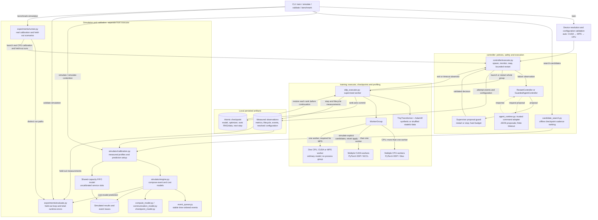

# TensorFleet architecture and recovery contracts

## Component boundaries

The diagram represents the implemented system. Single-worker paths do not use DDP.
CUDA/NCCL is implemented but has not been run on this Apple host; the capacity
simulation remains uncalibrated. Decision rationale lives in
[ADR-0001](adr/0001-platform-aware-training-architecture.md).

Solid arrows show implemented control or data flow; dashed arrows show the optional
agent adapter exchange. Candidate search ranks simulated checkpoint cadences offline. Simulated results
are not currently fed into live control decisions. The agent adapter is implemented; the example does not call an LLM.

Training, simulation, orchestration and agent adapters remain separate. PyTorch
DDP performs gradient synchronization. The simulator never launches training;
the benchmark command explicitly launches real runs before computing predictions.

## Module ownership

The package lives under `src/tensorfleet`; repository-level `tests/` stays outside
the installed distribution. [ADR-0002](adr/0002-modular-package-boundaries.md)
records the module reorganization.

- `training/ddp_executor.py` runs model updates; `checkpoint.py` persists state;
  `profiler.py` collects real metrics. Data/model/device/group helpers remain here.
- `controller/observations.py` holds immutable contracts; `policies.py` supplies
  rules and guarded agents; `safety_validator.py` validates proposals;
  `executor.py` owns process lifecycle. `candidate_search.py` ranks checkpoint
  cadences offline; `agent_runtime.py` owns the external command adapter.
- `simulator/engine.py` composes `event_queue.py`, `compute_model.py`,
  `communication_model.py` and `checkpoint_model.py`. `calibration.py` loads
  measured costs and configures predictions. `contention.py` retains FIFO capacity
  scenarios and shares the event queue.
- `experiments/runner.py` launches real campaigns; `failure_scenarios.py` builds
  reproducible failure/straggler configurations; `evaluate.py` scores held-out runs.

The simulator and offline candidate search do not import PyTorch, the training
executor, or experiment runners. Existing CLI commands and persisted file schemas
are retained; pre-1.0 Python imports under `executor`, `orchestration`, and the old
simulator `profile`/`validation` modules have moved to the owners above.

## Executor and stochastic recovery

Each local worker is spawned with a fresh shared FileStore rendezvous per attempt.
The CLI resolves available capabilities in CUDA → MPS → CPU order. Defaults
are at most two CUDA workers (one without NCCL), one MPS worker, or two CPU workers.
The Python TrainingConfig default remains two CPU workers; resolve_config exposes
automatic selection for Python callers. Concrete settings are persisted.

The WorkerGroup abstraction initializes distributed state only for more than one
worker. Distributed CPU uses Gloo. Distributed CUDA uses NCCL, binds rank N to
visible GPU N before process-group construction, and uses CUDA tensors for metrics
collectives. Single-worker CPU/CUDA/MPS uses the ordinary model and optimizer.
MPS rejects world sizes above one and performs no distributed collectives. MPS
training synchronizes the device before measuring elapsed time; float64 metric
aggregation stays on CPU because MPS does not support float64 tensors. CUDA timings
synchronize the device at the measurement boundary. Hardware validation rejects
missing CUDA/NCCL for DDP or insufficient visible GPUs before spawning workers. There is
no device fallback after selection. Deterministic algorithms are required; unsupported
operations raise errors. CUDA recovery is tested with numerical tolerances, not
claimed bit-exact across hardware, software versions, or DDP reduction orders.

The default dataset remains stateless arithmetic token sequences. With
`--stochastic-data`, a finite deterministic corpus is sharded by rank and shuffled
at each epoch with a dedicated generator. The stream owns its permutation,
generator state, epoch and cursor. Batch augmentation draws from Python and global
PyTorch CPU RNG; optional Transformer dropout exercises model RNG. The stream can
cross epochs inside a batch. No DataLoader prefetch or NumPy RNG is used. MPS RNG is restored through
torch.mps.set_rng_state after construction, alongside CPU/Python and data state.

Version 2 checkpoints contain model, AdamW state, configuration, next global step,
and all ranks' CPU/Python RNG, data stream and optional CUDA or MPS RNG states. Rank
states are gathered only at checkpoint boundaries from trusted local workers.
Rank zero writes a temporary file, fsyncs, atomically replaces the checkpoint and
fsyncs the directory. A barrier prevents advancement before commit. On restore,
model/optimizer/DDP and data stream are constructed first, then each rank restores
its own RNG and stream state before consuming its next batch. Adding prefetch,
NumPy transformations or additional generators requires checkpointing their state.

Version 1 deterministic CPU checkpoints remain readable using Phase 1 defaults.
They cannot restore stochastic training. Configuration changes affecting
model/data/backend identity are rejected. Cross-device checkpoint migration is
not a supported reproducible-resume operation. Changing total steps, checkpoint
cadence, timeouts or straggler injection is allowed. Resume in a fresh output
directory by copying only `checkpoint.pt`.

## Supervisor and agent guard

The supervisor detects a worker exit or attempt deadline, terminates/reaps all
workers and consults its controller. Collective timeouts bound peer waits. Both
the controller and supervisor enforce the restart budget. Per-directory exclusive
locks prevent simultaneous writers. A hard-killed supervisor can leave a stale
lock; verify no workers remain before manually removing it.

The controller action set is deliberately `restart` or `stop`. The proposal guard
checks exact schema, a nonempty reason of at most 512 characters, failed-group
state, and the hard restart budget. It guards every controller, including rule
policies. Invalid actions or exceptions stop safely and are recorded in
`events.jsonl`; controllers cannot change model settings or execute shell actions
through a decision. `GuardedAgentController` calls an `AgentRuntime` adapter and
fails closed on rejected proposals.

`CommandAgentRuntime` sends an observation as JSON on stdin to an explicitly
selected trusted local command. The command returns JSON on stdout. It is invoked
without a shell, has a finite timeout and response-size check, and its process
group is reaped on completion/timeout. Response files avoid unbounded in-memory
capture, but the command is **not sandboxed**, has the user's permissions, and
output limits are checked after completion. A Python runtime implementation used
programmatically must provide its own finite deadline. The included deterministic
adapter is a runnable contract demonstration, not an LLM. A provider-specific
adapter may make an LLM request and return the same limited proposal schema.

## Measurement scope

Each measured step reports global mean loss, maximum per-rank training duration,
all rank durations, global tokens/second, summed sampled RSS, checkpoint time,
orchestration overhead and rank-zero wall time. Training duration covers batch
creation/augmentation, optional injected delay, device transfers, forward,
backward, DDP synchronization, optimizer update and accelerator synchronization.
Checkpoint time includes rank-state gathering, atomic saving and commit barrier.
Overhead covers metrics collectives and remaining barrier costs. Rank-zero log
writes are measured as training-loop residual when building a cost profile.
Summed RSS can double-count shared pages and is not peak RSS. CUDA allocated and
peak allocated bytes are summed per worker and are distinct from RSS and total GPU
memory. MPS reports current allocated tensor bytes and driver-allocated bytes,
not peaks. These cannot be added to RSS to estimate physical usage on Apple unified
memory. Model and optimizer state size remains fixed during these experiments.

Lifecycle records measure time from supervisor spawn to ready (including initial
checkpoint) and the training loop. Supervisor events measure each attempt's
wall time through worker teardown and decision. These are separate from individual
step metrics. Attempts containing rolled-back work retain their own files.

## Discrete events and contention

`EventQueue` orders equal-time events by insertion order and rejects events in
its simulated past. `ComputeModel` cycles measured work durations and applies
explicit slowdown/straggler assumptions. `CommunicationModel` defaults to zero
additional cost because current measured DDP profiles already include communication.
Explicit separate communication samples require `durations_include_communication=False`
and truly isolated compute samples supplied by the caller. The executor does not
currently produce isolated compute/communication profiles, and no network
bandwidth/topology extrapolation is implied. `CheckpointModel` owns cadence,
write/restart cost and committed progress.

The event engine schedules step start/completion, checkpoint completion, failure
and restart. Checkpoint progress commits only when its modeled write completes.
Explicit checkpoint, overhead, startup, teardown and restart costs contribute to
elapsed time. Failure occurs once before a chosen step and replays uncommitted
steps. A scalar slowdown and step-range delay represent specified contention or
straggler scenarios. Restart cost inferred from a clean profile is an assumption;
failure detection and restart warm-up still need calibration with failed runs.

The separate FIFO service-slot model schedules concurrent jobs' worker service
and waits for all workers before each job advances. Capacity limits introduce
queueing. **Slots are abstract service capacity, not physical CPU cores.** Profiled
DDP durations include communication and are only a coarse proxy for service
demand. The capacity model is unit-tested but has not been calibrated against
actual overlapping jobs or CPU stress. Injected sleep delays validate a controlled
straggler scenario, not a general CPU contention model.

Offline checkpoint-candidate search evaluates at most 128 explicit cadences with
a fixed profile/configuration and optional failure step. It returns predictions
sorted by total simulated time with cadence as a deterministic tie-breaker. It
does not mutate profiles, change live training or expand guarded controller actions.

## Accuracy validation

Calibration requires a full successful single-attempt run from step zero.
Held-out runs must be distinct and match the model/data/device configuration and
recorded environment. Baseline, checkpoint-every-step and injected-straggler
campaigns execute independently and compare predictions with measured training
loop and total attempt time. Absolute relative error is reported for each scope;
a configurable gate checks every case and returns CLI exit code 2 on failure.
A low total-runtime error cannot hide a high training-loop error.

The cost model uses measured durations and mean checkpoint/overhead costs;
profiles cycle for projections longer than the calibration, including cold-step
samples. This is unsuitable for unvalidated long-horizon extrapolation. Hardware,
worker-count and model-size changes require new calibration. Campaign errors are
sample results, not confidence bounds or guaranteed prediction accuracy. Output
labels always distinguish `measured`, `simulated` and validation comparisons.

## Remaining milestones

- Calibrate actual overlapping jobs, pure CPU service demand, network and filesystem
  contention; separate cold start and steady state, and publish confidence intervals.
- Calibrate failure detection, teardown and restart warm-up using failed-run profiles.
- Validate CUDA/NCCL on a two-GPU Linux host and add a GPU CI lane.
- Add an actual provider adapter and offline agent evaluations before expanding actions.
- Add real datasets, prefetch-aware cursor recovery and eventually multi-node execution.

## Primary references

- [PyTorch DDP tutorial](https://docs.pytorch.org/tutorials/intermediate/ddp_tutorial.html)
- [PyTorch distributed and NCCL device selection](https://docs.pytorch.org/docs/stable/distributed.html)
- [PyTorch reproducibility](https://docs.pytorch.org/docs/stable/notes/randomness.html)
- [PyTorch MPS backend](https://docs.pytorch.org/docs/stable/notes/mps.html)
- [MPS RNG restoration](https://docs.pytorch.org/docs/stable/generated/torch.mps.set_rng_state.html)
- [CUDA RNG state](https://docs.pytorch.org/docs/stable/cuda.html)
- [TorchElastic](https://docs.pytorch.org/docs/stable/elastic/run.html)
- [Ray Train](https://docs.ray.io/en/latest/train/train.html)
- [Vidur](https://github.com/microsoft/vidur)

TensorFleet takes inspiration from these systems; it does not claim to implement
Ray Train, TorchElastic membership, or Vidur's GPU/operator simulation model.

## Architecture maintenance log

Review this diagram, the affected contracts and the [ADR index](adr/README.md)
after every meaningful implementation step, as required by [AGENTS.md](../AGENTS.md).
Update the diagram when structure or behavior changes; otherwise record that it
was reviewed and remains accurate. Preserve decision history through superseding
ADRs when a decision changes.

- **2026-10-12 — Architecture documentation foundation:** recorded the existing
  platform-aware executor, stochastic checkpoint recovery, guarded orchestration
  and separate simulation/validation design in ADR-0001. Replaced the ASCII sketch
  with the canonical Mermaid diagram. Added persistent maintenance guidance and
  navigation links. Runtime architecture is unchanged by this documentation step.
  Verification: Mermaid parser accepted the diagram, all 29 local documentation
  links/anchors resolved, and `git diff --check` passed. Runtime tests were not
  rerun because this step changes documentation and contributor guidance only.

- **2026-10-12 — Phase 1 commit preparation:** reviewed ADR-0001 and the canonical
  diagram against the completed implementation; architecture remains unchanged.
  The latest runtime verification remains 41 tests passed and one CUDA test skipped,
  with successful MPS failure recovery and passing lint. Documentation-only work
  since that verification passed link, Mermaid and whitespace checks.

- **2026-10-12 — Restructure step 1:** moved numerical execution into `training`,
  process supervision and policy contracts into `controller`, and campaign/evaluation
  into `experiments`. Extracted real metric collection into `training/profiler.py`
  and reusable experiment scenario builders. Updated imports and diagram ownership;
  execution, checkpoint and CLI behavior remain unchanged. Verification: 33 unit
  tests passed and lint passed after the moves.

- **2026-10-12 — Restructure step 2:** extracted the stable event queue, profiled
  work/communication contracts and checkpoint cost/progress model. Consolidated
  profile loading/prediction in `simulator/calibration.py`; added bounded offline
  checkpoint-candidate search and its CLI. Updated the Mermaid flow and ADR-0002.
  Existing unit tests still pass; dedicated cost-model and integration verification
  follows this completed decomposition.

- **2026-10-12 — Restructure step 3 verification:** reviewed the final module
  boundaries, canonical diagram and ADR-0002; the step 2 architecture remains
  accurate. Added regression coverage for event ordering, cost composition,
  checkpoint rollback, bounded candidate ranking, import isolation and the search
  CLI. Full suite: 48 passed, one two-GPU CUDA test skipped on this Mac. Ruff lint
  and formatting passed. Built a wheel and verified new modules are packaged and
  obsolete modules are absent. Exercised simulation, contention, candidate search
  and validation CLI commands. A fresh 100-step CPU/Gloo calibration campaign with
  three held-out runs passed the 25% per-case error gate: mean loop error 13.6%,
  mean total-runtime error 7.5%. These are single-campaign validation observations,
  not general accuracy guarantees. A pre-refactor stochastic MPS checkpoint resumed
  from step 10 through step 12. Mermaid parsing, all 36 local documentation
  links/anchors and `git diff --check` passed. Updated README layout and migration
  guidance; checkpoint and metrics schemas remain unchanged.

- **2026-10-12 — Redundant-file cleanup:** consolidated overlapping GitHub Actions
  workflows into `tests.yml`, preserving Linux Python 3.11/3.12 and macOS Python
  3.12 coverage, dependency installation, lint, tests, compilation and whitespace
  checks. Removed generated build copies, local test/lint/bytecode caches, the
  bytecode-only `src/tensorfleet_sim` remnant and empty research/configuration
  directories. Retained the documented literature validator and recorded training
  artifacts. Reviewed both accepted ADRs and the canonical diagram; runtime
  architecture and decisions remain unchanged. Verification: 48 tests passed,
  one CUDA test skipped; lint, formatting, workflow YAML/matrix checks and
  `git diff --check` passed. The consolidated workflow has not run on GitHub yet.

- **2026-10-12 — CI dependency and release checks:** investigated the failed
  GitHub run and declared NumPy as a runtime dependency because PyTorch object
  collectives use it during checkpoint-state exchange. The single CI workflow now
  covers Linux Python 3.10/3.11/3.12 and macOS Python 3.12, uses Linux CPU wheels,
  checks formatting, installs and smoke-tests the built wheel, and uploads JUnit
  reports. Added bounded job duration, cancellation of superseded runs and pip
  caching keyed to project metadata. Reviewed ADR-0001, ADR-0002 and the canonical
  diagram; runtime architecture remains unchanged. Local verification after a
  fresh editable dependency installation: 48 passed, one CUDA test skipped; lint,
  formatting, workflow YAML/matrix and whitespace checks passed. GitHub execution
  will validate the cross-platform matrix before merging.

- **2026-10-12 — CI action runtime update:** the first GitHub run passed all three
  Linux lanes but reported deprecated Node 20 action runtimes. Updated checkout,
  Python setup and artifact upload to explicit released versions using Node 24;
  verified each release's action metadata and the inputs used by this workflow.
  Reviewed the canonical diagram and both ADRs; architecture remains unchanged.
  The updated workflow will run the full matrix again before merge.

- **2026-10-12 — Hosted-runner test diagnostics:** Linux passes the updated action
  matrix, while hosted macOS testing takes substantially longer than local tests.
  Enabled unbuffered per-test progress, 60-second diagnostic stack dumps and an
  eight-minute test-step limit to make stalls actionable. No test is excluded and
  no failure is ignored. Reviewed the diagram and ADRs; architecture is unchanged.

- **2026-10-12 — Hosted Gloo environment:** diagnostic logs located the macOS
  stall at the first distributed recovery test after successful unit tests.
  Selected the platform's loopback interface explicitly for single-host CI Gloo
  traffic, requested the latest Python patch release, and exposed worker output.
  These are CI environment changes; the precise cause of the stall is not yet
  established. The diagram and accepted ADRs remain accurate and unchanged.

- **2026-10-12 — macOS CI interpreter selection:** hosted Python 3.12 continued
  stalling during process supervision with explicit loopback networking. Select
  Python 3.13 for macOS CI to match the locally verified interpreter; Linux retains
  Python 3.10/3.11/3.12 coverage. Document the unresolved hosted macOS 3.12 limitation
  rather than claim that its runtime was fixed. Full macOS tests remain enabled.
  Reviewed both ADRs and the diagram; runtime architecture is unchanged.

- **2026-10-12 — Hosted-runner evidence correction:** logs retrieved after the
  loopback-configured Python 3.12 rerun was cancelled show that both distributed
  stochastic recovery cases passed. The preceding entry's inference of continued
  stalling was premature; these observations do not establish a Python 3.12
  incompatibility. Removed that claim from README. Keep macOS CI on Python 3.13
  to match the local setup, with full Linux Python 3.10/3.11/3.12 coverage.
  Architecture and the accepted ADRs remain unchanged.

- **2026-10-12 — Cross-platform CI verified:** [GitHub run 38314630981](https://github.com/adi-swe/TensorFleet_LLM/actions/runs/38314630981)
  passed all four jobs. macOS Python 3.13 passed 48 tests, including MPS recovery,
  with one CUDA skip. Linux Python 3.10/3.11/3.12 each passed 47 tests with two
  hardware-dependent skips. Every lane passed lint, formatting, wheel installation
  and both CLI smoke tests. Source and workflow are unchanged since this successful
  run; final edits only correct the hosted-runner evidence and record verification.
  Reviewed the Mermaid diagram and both ADRs; architecture remains unchanged.
